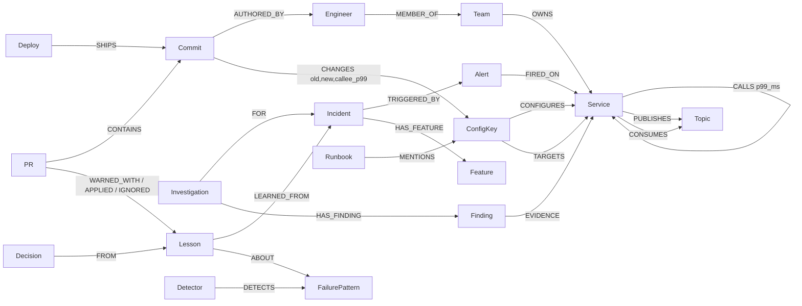

# Why-Graph

**Your AI engineers ship around the clock. Why-Graph works out why production broke, proves every claim with a
path in a FalkorDB graph, and makes sure no agent ships the same mistake twice.**

Built for [Graph Hacks: Context for AI Agents](https://www.wemakedevs.org/hackathons/falkordb) (WeMakeDevs ×
FalkorDB, 15–18 Oct 2026) by Solai ([@redwing-381](https://github.com/redwing-381)), Shoban
([@shobanravichandran](https://github.com/shobanravichandran)) and Sakthi
([@ShakthiSundar-K](https://github.com/ShakthiSundar-K)).

- **Demo video:** _link added at submission_
- **Demo app the agents ship to:** [redwing-381/astro-shop](https://github.com/redwing-381/astro-shop)
- **Attach it to your own repo:** the "Adopt it" tab in the UI (`/#docs`)

## Tracks entered

| Track | Where it shows up |
|---|---|
| **1. Agents that act on connected data** | Root alert, blast radius and suspect ranking are multi-hop Cypher over services, deploys, commits and config. The agents page owners through `OWNS` edges, and the same tools are served over MCP to outside agents, which act on them by blocking or fixing PRs. |
| **2. Agent memory and coordination** | Four agents share one graph as a blackboard (`Investigation → Finding → EVIDENCE`). Memory comes in three kinds: episodic (incidents, findings), semantic (lessons, failure patterns, vectors) and procedural (detectors stored as Cypher). It survives restarts, and each tenant has its own graph. |
| **3. Company brain** | People, teams, agents, ownership, commits, runbooks and decisions sit in one graph. The Brain answers "who knows payment?" and "why is shipping→quote set to what it is?" by tracing the decision back to the incident and PR, and it flags runbooks that went stale. |

## The demo, as it really ran

We ran Act 1 live on 18 Oct. Our AI engineering team works in Band, as five Claude Code agents with Why-Graph
as their MCP server.

1. **The mistake.** `wg-chaos` opened [astro-shop PR #1](https://github.com/redwing-381/astro-shop/pull/1) to
   "reduce checkout latency" by cutting `checkout.timeouts_ms.payment` from 800 to 200 ms.
2. **No memory yet.** `wg-reviewer` called `check_change_risk`. Why-Graph honestly answered *no known risk*,
   because the graph had never seen this failure. The PR was merged.
3. **It breaks.** The deploy shipped, checkout's error rate hit 62% and frontend's 41%. The alerts opened
   INC-1031.
4. **The agents explain it.** Each claim below is a grounded graph path:
   - Triage: *root alert is checkout; payment below it is healthy; frontend suffers synchronously, accounting and
     fraud-detection asynchronously.*
   - Cause: *commit b9f6186 (PR #1) cut the payment timeout to 200 ms, below payment's p99 of 446 ms.*
   - Memory: *no strong match, a new failure pattern.*
   - Comms: drafted the status update and paged the payments on-call and the PR author.
5. **It learns.** One click on *Confirm the root cause and the fix* wrote:
   - lesson **L-1**: a caller timeout must stay at or above 1.5× the callee's p99;
   - a decision;
   - detector **D-1**, stored Cypher that had to fire on INC-1031 before it was saved. Its backtest fired on
     1 of 39 past config changes.
6. **It prevents.** In Act 2 a fresh agent session tries `shipping.timeouts_ms.quote` 600 → 100 on a different
   service. `check_change_risk` now returns **high risk**, cites L-1 from INC-1031 and gives `safe_min = 453`.
   The same call against the `whygraph_fresh` graph (same code, never learned) returns *no known risk*.

## Why the graph is not decoration

- **Graph-only mode** (`GRAPH_ONLY=true`, or the toggle in the Brain tab) turns the LLM off. The root cause,
  evidence paths, lesson match and risk verdict stay the same, because they come from Cypher. Claude only
  writes the narrative.
- **No claim without a path.** `record_finding` re-runs the cited catalog query and rejects the finding unless
  every node and relationship it names is in the result. Confidence is computed from graph signals (hops,
  recency, Jaccard, detector hits), never by the LLM.
- **Detectors are stored Cypher.** What the system learned is a query you can read, run and backtest, not a
  hidden prompt.
- **Run live.** Click any finding in the UI to see its query and parameters, then *Run live* to re-run it on
  FalkorDB and watch the path re-highlight.

## Architecture

```
 Band agents (Claude Code) ──PR──▶ GitHub: astro-shop
        │  MCP: check_change_risk · incident_report · why_is · who_knows · get_service_context
        ▼                                   │ merge to main
 Why-Graph API (FastAPI) ◀── POST /deploys · /telemetry · /alerts ── astro_sim (watches main, diffs config)
   ├─ /mcp/        FastMCP, bearer token
   ├─ orchestrator  Triage ∥ Memory(1) → Cause → features → Memory(2) → Comms  ── read/write ──▶ FalkorDB
   ├─ SSE stream   every event also recorded as JSONL, so replay looks exactly like live    (one graph per tenant)
   └─ /api/query/run  read-only, allow-listed catalog queries for "Run live"
 UI (React + Vite + @falkordb/canvas): Incident · PR Guard · Memory · Brain · Replay · Adopt it
```

- **Agents** (`whygraph/agents/`): the orchestrator is deterministic Python.
  - Triage, Memory and Comms use deterministic queries, with optional Haiku phrasing.
  - Cause is the one open-ended Claude tool loop (`claude-sonnet-5-5`), limited to catalog tools and a step
    budget.
  - Every agent falls back to graph-only if the LLM fails.
- **Memory** (`whygraph/memory/`):
  - feature extraction, which turns an incident into service-agnostic facts such as
    `motif:timeout_lt_callee_p99` and `author:agent`;
  - lesson write-back;
  - detector templates, self-validation and backtests.
- **Integrations** (`whygraph/integrations/`): event ingest, the MCP server, and PR Guard (comments verdicts on
  GitHub PRs when `GITHUB_TOKEN` is set).

## Graph model



The full model, constraints and indexes are in [docs/schema.md](docs/schema.md). Vector indexes (Voyage
`voyage-4-lite`, 1024 dims) cover incidents, lessons and runbooks. A full-text index covers runbooks and chat.
All writes are idempotent `MERGE`s, so agents can write concurrently. The demo graph holds about 950 nodes and
2,200 relationships: a synthetic company of 30 services, 6 teams, 20 engineers and 2 agents, about 120 deploys over 30 days,
and 20 past incidents across 6 failure patterns. The timeout pattern is deliberately missing, so Act 1 is
genuinely new.

## Query catalog

Agents can only call named queries from `whygraph/graph/queries.py`. The same catalog drives the agent tools,
the MCP tools, "Run live" in the UI and [docs/queries.md](docs/queries.md). Times are from the live INC-1031
run on a laptop (FalkorDB 4.22.1 in Docker).

| Query | What it answers | Measured |
|---|---|---|
| `root_alert` | Which alerting service is the root: alerting while nothing it calls (up to 4 hops down) is alerting. | 11.0 ms |
| `blast_radius` | Who suffers: callers up to 5 hops, with async consumers of its topics listed separately as delayed. | 4.3 ms |
| `suspect_changes` | What changed right before the alert, on the root service, its dependencies, or config that targets them, ranked by recency, hops and history. | 10.6 ms |
| `config_vs_reality` | Did the commit set a timeout below the callee's p99 at the time of the change? | 16.9 ms |
| `similar_incidents` | Past incidents with the same shape: Jaccard over service-agnostic features, so checkout→payment matches shipping→quote. | 53–107 ms |
| `similar_incidents_vec` | The same, by Voyage embedding (FalkorDB's score is a cosine distance, so similarity = 1 − score). | |
| `who_knows` | Owners, on-call, committers and past resolvers of a service, agents included. | 9.3 ms |
| `guard_timeout_below_p99` | Detector D-1 as a query: flags proposed timeouts below 1.5 × the callee's p99 and returns `safe_min`. | |
| `why_is` | The history behind a config value: commit, PR, author, and the PR → Decision → Lesson → Incident chain. | |
| `doc_search` | Full-text search over runbooks and incident chat. | |
| `criticality` | PageRank over `CALLS`, run inside FalkorDB (`algo.pageRank`). In the catalog, not yet wired into severity. | |
| `stale_runbooks` | Runbooks that mention a config key changed after the runbook was last updated. | |
| `detector_backtest` | Every historical config change, used to count how often a new detector would have fired. | |

## Run it

You need Docker, [uv](https://docs.astral.sh/uv/) and Node 22.

```bash
cp .env.example .env            # ANTHROPIC_API_KEY, VOYAGE_API_KEY, WHYGRAPH_API_TOKEN
make install                    # uv sync + npm install
make db                         # FalkorDB on :6379, Browser on http://localhost:3000
uv run python -m seed.load --reset --no-act1   # demo + fresh tenants, Act 1 left for the live run
make api                        # http://localhost:8000 (OpenAPI at /docs)
make ui                         # http://localhost:5173
make test                       # 167 tests; DB tests skip if FalkorDB is down
```

- **No API keys?** Set `GRAPH_ONLY=true` and load with `--no-embed`. Everything still works from the graph.
- **To replay Act 1 without agents or a repo:** run `uv run python scenarios/inject.py act1`.
- **For the live loop:** run `uv run python scenarios/astro_sim.py` to watch astro-shop. It posts real deploys
  from real config diffs.
- **To share one public URL:** run `cloudflared tunnel --url http://localhost:5173`. The UI proxies `/api` and
  `/mcp`.

The full live setup (Band agents, MCP and the act-by-act script) is in
[scenarios/band-team.md](scenarios/band-team.md). The agent-facing kit is in
[scenarios/sde-agent-kit.md](scenarios/sde-agent-kit.md).

## What is real and what is simulated

| Real | Simulated |
|---|---|
| The GitHub repo, PRs, reviews and merges, opened by AI agents in Band | The shop's runtime: `astro_sim.py` computes error rates and p99s from `latency_ms` instead of running nine services |
| Config diffs, parsed from `services.yaml` between commits | Alerts, raised by the simulator when a timeout sits below the callee's simulated p99 |
| Every graph query, the agents' Claude calls, Voyage embeddings, MCP calls | The company history: 30 days of deploys and 20 past incidents, generated by `seed/generate.py` |
| Lessons, detectors and backtests written to FalkorDB, surviving restarts | |

## Repo layout

```
whygraph/      api (FastAPI routes) · graph (client, schema, query catalog) · agents · memory · integrations · models
seed/          synthetic company generator, loader, embedding cache
scenarios/     astro_sim (live loop), inject (replay), act scripts, Band team setup, recordings
scripts/       FalkorDB smoke test, query docs generator, graph snapshots
tests/         167 tests, including the whole demo end to end on the real seed (tests/test_e2e_act1.py)
ui/            React + Vite + TypeScript, FalkorDB's @falkordb/canvas
```

We built it as one branch and PR per feature into a protected `main` with CI. The plan is in
[docs/plan.md](docs/plan.md) and the split in [docs/work-split.md](docs/work-split.md).

## Data and licensing

All company data is synthetic. The core service topology follows the
[OpenTelemetry Demo](https://github.com/open-telemetry/opentelemetry-demo) "Astronomy Shop" (Apache-2.0).

## AI usage disclosure

- **Building:** we used AI coding assistants (Claude Code) while building, and we reviewed every change that
  was merged.
- **In the product:** Claude (`claude-sonnet-5-5`, `claude-haiku-5-5`) writes narrative and runs the Cause tool
  loop. Voyage provides embeddings. Neither decides root cause or confidence; the graph does.
- **In the demo:** the AI engineering team in Band (five Claude Code agents) acts as an outside user of
  Why-Graph. It opens PRs against astro-shop and calls our MCP tools.
- **New work:** all Why-Graph and FalkorDB work in this repo was written during the hackathon.
